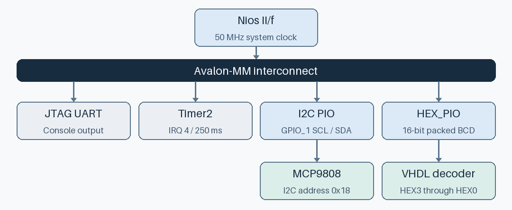
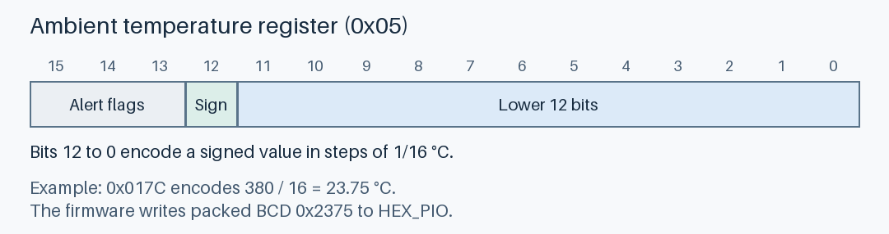

# DE1-SoC Nios II I2C thermometer

A Nios II/f system on a Terasic DE1-SoC reads a Microchip MCP9808 temperature
sensor through a software-driven I2C master. It sends the result to the JTAG
UART console and displays four decimal digits on the board.

## System architecture



Timer2 raises IRQ 4 every 250 ms. The firmware advances the LED indicator on
each tick and reads the sensor every four ticks. The I2C PIO drives SCL and
open-drain SDA through the GPIO header. The firmware writes four packed BCD
digits to `HEX_PIO` for the VHDL seven-segment decoder.

The sensor register has a resolution of 1/16 °C. The firmware ignores the
three alert flags and converts the signed reading to hundredths of a degree.
For example, 23.75 °C prints as `Temperature = 23.75 C` and appears as
`2375` on HEX3 through HEX0. Negative readings and readings above 99.99 °C
appear as `0000` on the displays. An I2C acknowledgment error produces a
console message and clears the display.



The full address map, wiring and I2C transaction are in
[System architecture](docs/architecture.md).

## Host tests

Run from the repository root with GNU Make and a C99 compiler:

```sh
make test
```

The tests exercise the firmware's signed decoding, alert-bit masking,
four-digit BCD conversion and NACK handling with a scripted I2C bus.
GHDL, when installed, checks the top-level and PLL-wrapper VHDL syntax
using a test-only declaration of the vendor PLL interface. The runner
reports a skip when GHDL is unavailable.

`make all` builds the host test executable. `make clean` removes host build
products. To regenerate the diagrams, install the optional Python dependency
with `python3 -m pip install -r requirements.txt` and run `make figures`.

## Board build and limits

The reference build used Quartus Prime 18.1 Standard Edition, Platform
Designer and Intel FPGA Monitor Program 18.1 with the Nios II toolchain.
Use a 3.3 V MCP9808 module with SCL and SDA pull-ups. Connect SCL to
`GPIO_1[11]`, SDA to `GPIO_1[12]`, and share ground. The
[board build guide](docs/build.md) covers project generation, programming
and firmware loading.

The historical Quartus build used 2,153 of 32,070 ALMs and reported
+0.126 ns minimum hold slack on constrained paths. The timing report
listed 19 unconstrained inputs and 79 unconstrained outputs. Console,
LED and display operation were previously observed on a DE1-SoC.
This revision has host test and syntax-check coverage. Quartus
implementation, Nios II linking and board operation remain unverified
for this revision, and the SCL period has not been measured. See
[Verification evidence](docs/verification.md).

## Licensing

The [MIT License](LICENSE) covers original contributions. The files
`sprint.c` and `sprint.h` retain their GNU LGPL version 2 or later terms,
with the [LGPL-2.1 text](LICENSE-LGPL-2.1) included. See [NOTICE](NOTICE)
for the base design and third-party attributions.
